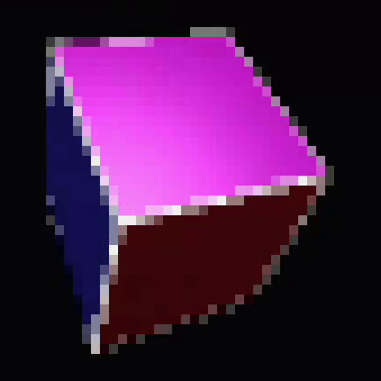
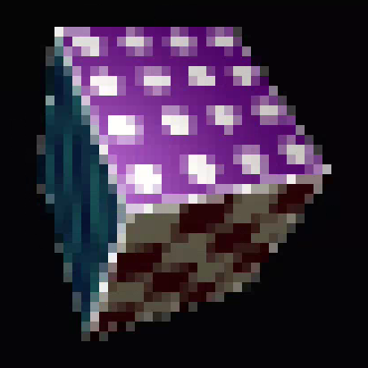
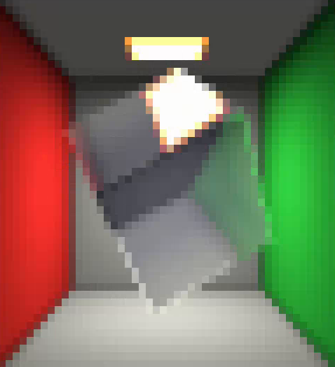
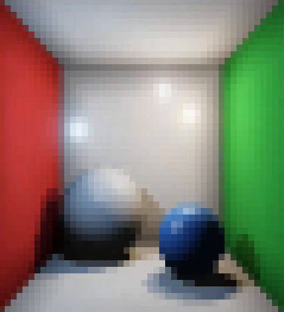
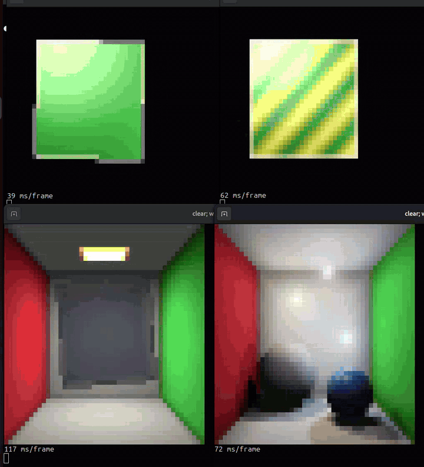

# Raytracing Benchmarks

Each query renders an animated 3D scene in pure SQL and returns it as ANSI true-color text, with one output row per terminal line.
Every character cell shows two pixels by using half-block characters, and every pixel averages four sub-pixel rays for anti-aliasing.
The scenes are animated with `now()`, so each run of a query renders the next frame.

## Usage

Run [`setup.sql`](setup.sql) once to create and fill the ray tables that the scene queries read from.
Then run any scene query in a loop and print its `line` column to see the animation in your terminal.
The example below uses a Firebolt Core server on `localhost:3473`.

```sh
clear; while true; do printf '\e[H%s\n' "$(curl -s localhost:3473 --data-binary @shadow.sql)"; done
```

## Scenes

| Scene | Description |
| --- | --- |
|  | **[basic.sql](basic.sql)**<br>A rotating cube with a different color on each face. Three point lights shade it with the Phong model, which gives each face diffuse light and specular highlights. |
|  | **[textured.sql](textured.sql)**<br>The same rotating cube with a procedural pattern on each face, such as a checkerboard, stripes or rings. The patterns are computed from the hit position and lit with the same Phong shading. |
|  | **[reflecting.sql](reflecting.sql)**<br>A glass cube rotates inside a Cornell box with a lamp on the ceiling. Each ray splits into a reflected and a refracted path, and a Fresnel term blends the two by viewing angle. |
|  | **[shadow.sql](shadow.sql)**<br>Two spheres sit in a Cornell box lit by three moving colored lights. Shadow rays test each light against the spheres, and the lights glow where a camera ray passes close to them. |


